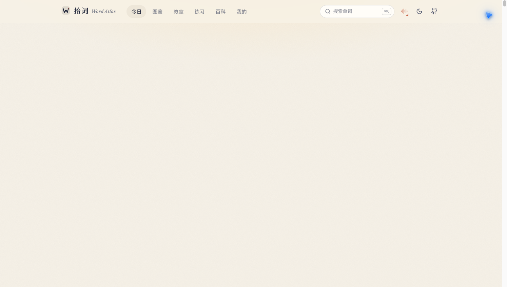
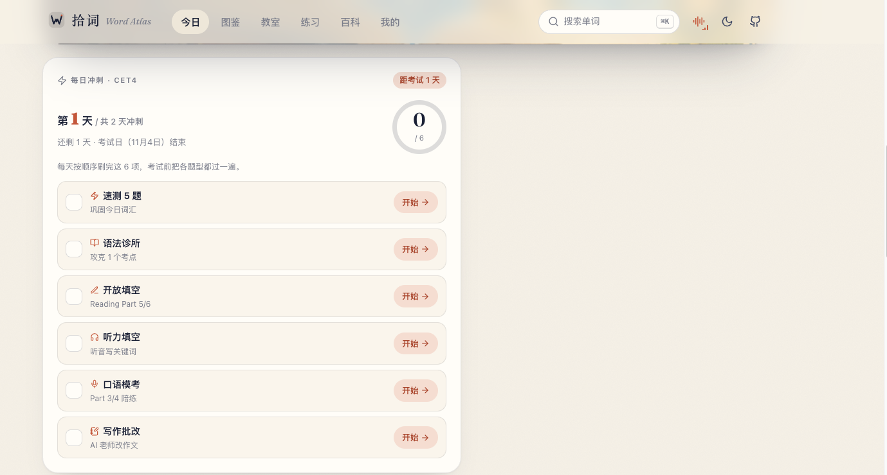

# 拾词 · Word Atlas

**把单词变成画面，让复习有迹可循。**

7,000+ 剑桥 KET/PET 词条 · 原创插画 · 英美发音 · AI 伴学 · FSRS 间隔复习

[**立即体验 ↗**](https://0xlei.tech/words/)　 /　 [48 秒介绍](docs/assets/launch.mp4)　 /　 [English](README.en.md)

 

**拾词 iOS 正在开发，首批内测招募中。** 微信扫上图二维码进群；二维码过期或群满了，打开 [网站](https://0xlei.tech/words/) 点顶栏「内测」，加作者微信拉你进群。

---

## 🚀 获取完整版 · macOS 桌面应用

完整版把整个拾词打包成**桌面应用**：下载安装包、解压、双击即用，**无需 Node.js、无需命令行**，所有功能全量解锁。

**完整版包含**

- **全词库 7,000+ 词**（A1–C2，远超开源公开数据集的 KET/PET 范围），一词一画
- **AI 例句与迷你故事**：任意词即时生成 3 条例句 + 1 段 3 句迷你故事（本地 Ollama 驱动）
- **词音剧场**：例句逐词高亮朗读，英/美音 + 三档语速 + 单词语音跟读
- **任意词看图评分**：给你任意词卡，60 秒看图开口描述，关键词 + 核心词 + 长度三维评分
- **AI 随堂测**：考纲词表 × 完形/释义，AI 无限出题
- **每日晨读微课**：每天一篇用 3 个考纲词编成的迷你短文 + 中文对照
- 以及全部真题题型、KET/PET 模考、口语三段式、听力/完形/拼写/造句、错词本、收藏、星图、FSRS 间隔复习、进度导出

**价格**：**¥ 待定价**（个人买断，一次付费永久使用）

**购买方式**（付款后自动发货：安装包下载链接 + 使用说明）：

- 🛒 面包多 / 爱发电：`<!-- 待填：商品链接 -->`
- 📦 百度网盘：`<!-- 待填：链接 + 提取码（付款后随单发送） -->`

**安装**：下载 zip → 解压 → 双击 `Word Atlas.app`（macOS 首次打开如提示"无法验证开发者"，请**右键 → 打开**一次即可）。AI 功能使用本地 Ollama，首次使用前运行 `OLLAMA_ORIGINS="*" ollama serve`。

> 当前为 macOS 版（Apple Silicon）。Intel Mac / Windows 版制作中，敬请关注。

---

拾词是一款以插画和语境为核心的剑桥 KET/PET 背词应用。看画面理解词义，听发音建立联系，再用主动回忆和间隔复习巩固记忆。无需账号，学习进度保存在自己的设备上。

[产品预览](#产品预览) · [学习方式](#学习方式) · [发音与环境声](#发音与环境声样本) · [内容来源与局限](#内容来源与局限)

## 产品预览

### 一本可以听、可以练的单词图鉴

<table>
<tr>
<td width="50%"></td>
<td width="50%"></td>
</tr>
<tr><td align="center">每日计划，把注意力放在今天</td><td align="center">插画、词义、发音，在一张词卡里</td></tr>
</table>

### 学过的词，汇成自己的星图

19 个话题组成词汇星图。拖动旋转、滚动缩放，点击星星打开词卡；学习状态用不同亮度呈现。采用 WebGL2 渲染，不支持的设备提供降级显示。

<b>看 48 秒宣传片</b>

[播放完整视频（含声音）](docs/assets/launch.mp4)

## 学习方式

| 环节 | 你会做什么 |
| :--- | :--- |
| **看见** | 每个词配一幅插画、中英释义、两条原创例句，以及搭配、词族和用法提示。 |
| **听见** | 切换英音、美音，听日常例句朗读；对着麦克风跟读，应用实时对比发音并打分。 |
| **AI 例句** | 任意词即时生成 3 条例句 + 1 段迷你故事（本地 Ollama 驱动，10 秒内出结果）。 |
| **剧场** | 词音剧场：例句逐词高亮朗读，英/美音 + 三档语速，附单词语音跟读。 |
| **看图说** | 任意词看图评分：60 秒倒计时，关键词命中 + 核心词 + 长度三维评分，练 Speaking。 |
| **随堂测** | AI 随堂测：考纲词表 × 完形/释义，AI 无限出题，每次 4 题即时判分。 |
| **晨读** | 每日晨读微课：每天一篇用 3 个考纲词编成的 25–35 词迷你短文 + 中文对照，词卡直达图鉴。 |
| **备考** | 剑桥真题题型：完形填空、释义选词、看图选词，仿 KET/PET Reading 与 Speaking 出题，只测词义、不改记忆进度。 |
| **模考** | KET/PET 限时模考：Reading（完形/释义/看图）+ Listening（听句选词/填空）混合 20 题 + 倒计时自动交卷，出成绩单和错题回顾。 |
| **口语** | 三段完整口试流程：Part 1 考官问答 → Part 2 看图描述（配词条插画）→ Part 3 话题扩展，关键词评分 + 参考回答，可跳过。 |
| **测评** | 摸底测试按 A1→B1 递进测词汇量，推荐报考 KET/PET 并指出短板话题；PET 写作练习（邮件/短故事）含要点检查、字数与范文对照；临近考试时自动生成每日冲刺清单。 |
| **听力** | 听例句选词 + 听句子填空（Listening 风格，自动判分，交替出题）；今日页答题进度环支持自定义每日打卡目标，达成即点亮。 |
| **错题** | 答错的词自动进错题本：点词直达词条，一键「重练错题」再考一轮；「我的」页成绩趋势折线图展示历次真题/模考/听力得分走势。 |
| **徽章** | 学习里程碑徽章墙：点亮词数、连续天数、模考高分、打字与正确率共 12 枚，达成自动颁发；搜索支持中英文。 |
| **电台** | 单词电台：最近学过/收藏/薄弱词/全部词表任选，英音 → 美音 → 例句自动连播，暂停、跳词、从头重放，磨耳朵专用。 |
| **辨析** | 易混词辨析：borrow/lend、watch/see 等 16 组高频易混词，例句挖空 2 选 1，答后逐组讲解。 |
| **目标** | 设定 KET/PET 考试日期后，今日页显示倒计时并自动计算每日新词量；「我的」页提供近 7 天学习周报和各话题掌握度。 |
| **想起** | 看义选词、看图补句、听音辨词、拼写，逐步练习主动回忆。 |
| **速刷** | 词卡速刷：正反面 3D 翻卡（正面单词+音标+英/美音，背面插画+释义+例句），点「认识/不认识」十张一轮快速过词。 |
| **拼写** | 听音拼写：听单词默写，支持英/美音切换、回车判分、答错显示正确答案，练 KET/PET Listening 拼写题手感。 |
| **造句** | 中译英造句：看中文例句写英文，关键词宽松判分（相近表达也过关），答后给参考答案，练 Writing 输出。 |
| **对话** | 对话听力：8 段 KET/PET 风格双人对话（问路/点餐/周末/电影/找物/假期/改期/加班），听两遍选答案，答后展示原文，仿真 Listening Part 1。 |
| **百科** | 考试百科：KET/PET 试卷结构、评分标准（170 分满分分档）、备考节奏与题型小抄，一页讲清。 |
| **总览** | 词汇进度总览：A2/B1 掌握/在学/未学分布条 + 各话题掌握率 Top 10，「我的」页直达。 |
| **预测** | 模拟预测：按最近模考平均正确率三档判定（≥75% 把握较高 / 60–75% 有希望通过 / <60% 需要加强），附近 8 次成绩历史。 |
| **离线** | 离线学习：Service Worker 缓存应用外壳与词库媒体，断网后仍可打开应用复习已缓存的词条。 |
| **同义** | 同义反义配对：从词库 1,400+ 带同/反义词的条目随机出题，找词义最近的词，干扰词取自词库。 |
| **构词** | 构词法小课：un-/im-/dis-/-ly/-ful/-less/-er/-tion 等前后缀派生 10 题，每题带构词讲解。 |
| **闯关** | 话题闯关：19 个话题各 10 词，按英文释义选词，全对解锁下一话题（进度本地保存）。 |
| **发音** | 易错发音诊室：th 清浊/长 i: 短 ɪ/æ e/ʊ u:/r/v w 六组易混音，示范卡 + 听辨挑战。 |
| **听写** | 整句听写：听全量例句音频默写整句，关键词覆盖 ≥70% 即算过，答后给完整句与中文。 |
| **写作** | PET 写作范文仿写：Part 1 邮件 5 题 + Part 2 短故事 5 题，填词学套路（Hi/look forward to/was doing…when）。 |
| **清单** | 考前 24h 清单：距考试 ≤7 天时今日页出现，证件/文具/路线/耳机/睡眠逐项勾选（本地保存）。 |
| **成绩卡** | 成绩单分享卡：「我的」页生成本周学习数据卡（连续天数/已点亮词/分钟/词库进度/正确率），可截图分享。 |
| **写话** | KET 看图写话：6 幅场景插画（公园/餐厅/车站/图书馆/雪山/生日），提示「谁/在哪里/做什么」，写 1–2 句回车判分，关键词覆盖 ≥50% 算过，答后给参考句与中文。 |
| **说话** | PET 看图说话：6 幅场景图 + 60 秒倒计时（准备→开讲→对照三阶段），句型框架与参考描述 4–5 句，练 Speaking Part 2。 |
| **跟读** | 例句跟读模仿秀：从全量例句音频随机 8 句，听示范 → 20 秒模仿 → 对照，注意连读与重读。 |
| **匹配** | PET 阅读信息匹配：Reading Part 4 风格 5 题（需求句 → 3 选项公告），先划关键词再匹配，每题带讲解。 |
| **变形** | 单词变形擂台：go→went、child→children、good→better 等 10 题（过去式/复数/比较级/三单），每题带规则讲解。 |
| **变速** | 听力变速：0.75x / 1.0x / 1.25x 三档播放例句音频，先慢速听清单词再加速练连读。 |
| **收藏夹** | 生词收藏夹：「我的」页集中浏览收藏词（插画 + 词 + 释义 + 级别·话题），点开看例句听发音，可取消收藏。 |
| **记录** | 学习记录导出：进度 JSON（含设置）全量备份、错题 CSV（去重计数）、收藏 CSV，Export 页一键下载。 |
| **复习** | FSRS 根据学习记录安排复习，目标记忆率可调。只有首次作答计入正确率；错词与久未复习的词会聚合为「薄弱词」，在今日页优先推送。 |
| **积累** | 星图展示学习进度；打字练习独立统计；词表可按级别/话题/学习状态导出 CSV 或打印成 PDF；支持导出和恢复本地进度。 |

**本地优先。** 无需注册；看过的词条与媒体可缓存供离线使用。换设备前，请先导出进度备份。

## 发音与环境声样本

拿 *abandon* 举例，点开就能听（在线播放）：

| | |
|---|---|
| 🇬🇧 英音 | [abandon /əˈbændən/](https://0xlei.tech/words/atlas/audio/uk/abandon.mp3) |
| 🇺🇸 美音 | [abandon /əˈbændən/](https://0xlei.tech/words/atlas/audio/us/abandon.mp3) |
| 📖 例句朗读 | [We had to abandon our car in the snow.](https://0xlei.tech/words/atlas/audio/ex/abandon.mp3) |

### 环境声与交互声音

| | |
|---|---|
| 🎙 **开屏配音** | [「欢迎来到拾词，一起点亮剑桥词汇」](https://0xlei.tech/words/sfx/splash-voice.mp3)：星尘汇聚成"拾词"，大门打开 |
| 🌌 **星图配音** | [「这是你的词汇星图。每学会一个词，就点亮一颗星。」](https://0xlei.tech/words/sfx/voice-galaxy-hello.mp3) |
| 🎵 **星空音乐** | [一段可无缝循环的原创配乐](https://0xlei.tech/words/sfx/amb-stars.mp3)，默认陪你背词 |
| 🌧 **6 段环境声** | [雨天图书馆](https://0xlei.tech/words/sfx/amb-rain.mp3) · [清晨海岸](https://0xlei.tech/words/sfx/amb-sea.mp3) · [林间早晨](https://0xlei.tech/words/sfx/amb-forest.mp3) · [夜晚壁炉](https://0xlei.tech/words/sfx/amb-fire.mp3) · [远航船舱](https://0xlei.tech/words/sfx/amb-voyage.mp3) · [安静咖啡馆](https://0xlei.tech/words/sfx/amb-cafe.mp3) |
| ✨ **界面音效** | 答对、答错、翻卡、打字、连胜、点亮星星……每个操作都有自己的声音；读单词时背景音会自动压低 |

## 内容来源与局限

释义、例句、插画和录音为项目生成：文字与插画使用生成式 AI，语音使用合成语音。内容经过自动结构与一致性校验，**尚未逐条人工审校**，可能出现释义、例句、插画或发音错误。它不是官方剑桥词表，也不承诺提分。

## 授权

应用与词库内容为**专有产品**，版权所有 © zhixun1981-oss（拾词 Word Atlas）。未经授权，禁止复制、分发、出售或二次开发后发布。付费用户仅获得个人使用许可。

---

由 [@zhixun1981-oss](https://github.com/zhixun1981-oss) 制作。产品进展与制作过程见 [X · @yangleiocx3](https://x.com/yangleiocx3)。

如果拾词对你有用，欢迎把它分享给正在学英语的朋友。
